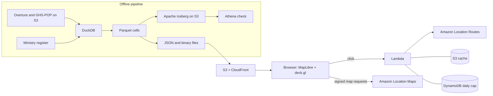

# Isolated Italy

[](https://github.com/kharo23/isolated-italy/actions/workflows/ci.yml)

An interactive map of how far Italian residents live from five essential services (pharmacy, doctor or hospital,
school, grocery, post office), built from open data on AWS. It also ranks the best sites for a new pharmacy, doctor
or school, and checks each candidate against a real 15-minute drive area from Amazon Location Service.

**Live map:** https://d2j20ezte5y45g.cloudfront.net

## What it shows

- A hexagon map (H3) of the number of essential services farther than a chosen distance, default 5 km.
  About 4.5 million residents (7.8%) live more than 5 km, in a straight line, from at least one of the five.
- Pharmacies cross-checked between two sources: 159,000 residents are far from a pharmacy in both the Ministry of
  Health register and Overture Maps, while each source alone gives about 535,000. A map view shows where they disagree.
- A click analysis: straight-line distance, road time and the 15-minute drive area, computed live by Amazon Location Service.
- "Where to build next": the 25 best sites per service, with the residents each would bring within 15 minutes.

## Data

| Data | Source | Licence |
|------|--------|---------|
| Places, buildings, administrative areas | Overture Maps, release 2026-10-21.0, from the Registry of Open Data on AWS | CDLA-Permissive-2.0, ODbL |
| Residents | GHS-POP R2023A, epoch 2025, 30 arc-second (JRC, `s3://jrc-ghsl`) | CC BY 4.0 |
| Pharmacies | Italian Ministry of Health, open register "Farmacie" | IODL 2.0 |

Residents are a modelled estimate spread over buildings, not a census count. See [NOTICE.md](NOTICE.md) and
[docs/method.md](docs/method.md).

## Architecture



See [docs/architecture.md](docs/architecture.md). The stack is a single CloudFormation template.

## Repository layout

```
src/isolated_italy/   data pipeline, one module per stage
tests/                unit tests for the pipeline and the Lambda
infra/                CloudFormation template, Lambda (reach API), deploy script
web/                  map client (Vite, MapLibre GL, deck.gl)
docs/                 method and architecture notes
```

## Getting started

Requirements: Python 3.11+, Node.js 20+, AWS CLI v2 for the AWS stages.

```sh
make install          # Python virtual environment and web dependencies
make lint test        # ruff, cfn-lint, eslint, pytest, vitest
```

Run the pipeline (`make data`, or the stages one by one with `python -m isolated_italy.<stage>`):

| Stage | Module | Needs AWS credentials |
|-------|--------|-----------------------|
| Buildings per H3 cell (res 8 and 9) | `buildings` | no (public bucket) |
| Services from Overture | `places` | no |
| Province, region, locality per cell | `admin` | no |
| Pharmacy register merge | `pharmacies` | no |
| Distance to the nearest service | `distances` | no |
| Modelled residents | `population` | no (public bucket) |
| Web data files | `export`, `services_bin` | no |
| Candidate sites | `sites` | no |
| Road validation of candidates | `validate` | yes (Amazon Location) |
| Iceberg table and Athena check | `lakehouse` | yes (S3, Athena) |

The pharmacy register is not stored in the repository. Download the active "Farmacie" CSV from
https://www.dati.salute.gov.it/it/dataset/farmacie/ to `data/official_farmacie/farmacie.csv` before running `pharmacies`.

Local development uses a placeholder basemap:

```sh
cd web && npm run dev
```

## Deploy

```sh
AWS_REGION=eu-central-1 ./infra/deploy.sh
```

The script deploys the stack, packages the Lambda, builds the site with the Cognito identity pool id and uploads it.
The daily routing cap defaults to 1000 calls (`DAILY_CAP`).

## Limitations

- The colour of the map uses straight-line distance. Road times are computed only on click and for recommended sites,
  and only for the pharmacy, doctor and school that are nearest in a straight line, so the time shown is an upper bound
  for the nearest by road.
- Residents are modelled from GHS-POP. The allocation places 57.9 million residents in Italy.
- Pharmacies come from two imperfect sources, merged conservatively. Doctors, schools, grocery stores and post offices
  come from Overture only and are not validated; school coverage appears the weakest.
- Small islands are left out of the locality ranking, and ferries are not modelled.
- Recommended sites are area-level suggestions and need local verification.

## Licence

Code: MIT, see [LICENSE](LICENSE). Data keeps its own licences, see [NOTICE.md](NOTICE.md).
