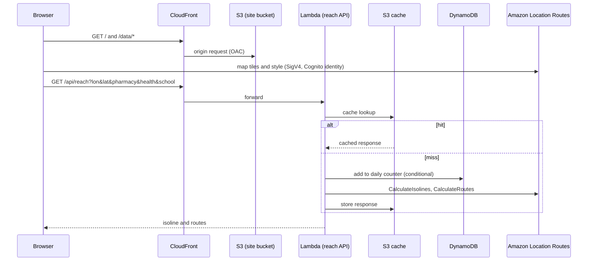

# Architecture

## Runtime

## Components

| Component | Purpose |
|-----------|---------|
| S3 bucket and CloudFront (OAC) | Static site and data files |
| Lambda `reach` | Validates input, caches, enforces the daily cap, calls Routes |
| DynamoDB table | One item per UTC day with an atomic call counter and a TTL |
| Cognito identity pool | Unauthenticated identity limited to read-only map actions, so no API key ships in the bundle |
| Amazon Location | Basemap, `CalculateIsolines`, `CalculateRoutes` |
| S3 lake bucket (private) | Parquet copy and Iceberg table for Athena, created by `isolated_italy.lakehouse` |
| Athena | Recomputes the headline numbers on the Iceberg table |

## Cost controls

- At most 4 routing calls per uncached click (1 isoline and up to 3 routes).
- A configurable daily cap (default 1000) enforced with a conditional DynamoDB update.
- Responses cached in S3 by a rounded origin and the exact destinations; a partial answer is never cached.
- The heavy computation runs once, offline.
- A monthly AWS Budget alert is recommended.

## Data flow

Pipeline outputs are written to `data/` (intermediate Parquet, not committed) and `web/public/data/` (served files):
`cells7.json`, `comuni.json`, `province.json`, `headline.json`, `sites.json`, `lakehouse.json` and `svc_<category>.bin`.
Column names of the intermediate tables keep the Italian terms `comune` and `prov` (locality and province).
